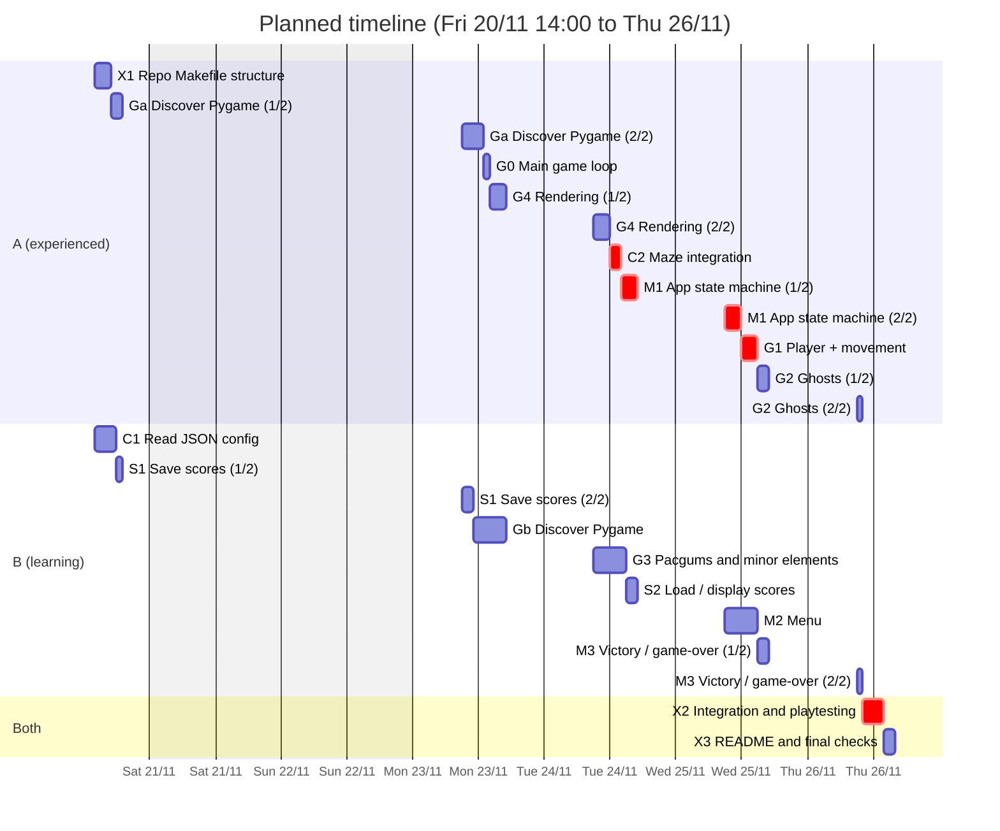

# Pacman Project: Planning & Progress Tracker

> Template: replace the `TODO` values with real information.
> Start: **Fri 2026-11-20 at 14:00**. No weekend work. Deadline: **Thu 2026-11-26** (5 working days).

## 1. Overview

| | |
|---|---|
| **Project** | Pacman (42 school) |
| **Deadline** | Thu 26/11, end of day (TODO: exact time) |
| **Availability (each)** | Fri 20/11 14:00-19:00 (5h) · Mon 23 → Thu 26/11 09:00-17:00 (8h/day) · **37h total** |
| **Planned workload** | Baseline: A ≈ 36h · B ≈ 36h. After re-plan (23/11): A ≈ 43.5h · B ≈ 44.5h (**over budget**, see risks) |
| **Team** | **A**: TODO name (experienced) · **B**: TODO name (learning) |
| **Stack** | Python, Pygame-CE, JSON, external maze-generation package |
| **Repo** | TODO link |

### Working principle

Tasks are **deliberately split unevenly**. B takes self-contained, lower-risk modules where she can learn a skill end to end (JSON, simple Pygame screens, small game elements). A takes the modules on the critical path (maze integration, movement, ghosts, rendering, main loop) and reviews B's work. Each of B's tasks is paired with a short review/pairing session so she learns from the feedback.

---

## 2. Work breakdown

Difficulty: 🟢 easy · 🟡 medium · 🔴 hard. Estimates are in working hours.

### Configuration (skill: JSON)

| ID | Task | Owner | Diff. | Est. | Depends on |
|----|------|:-----:|:-----:|:----:|------------|
| C1 | Read and validate the JSON config file (error handling) | B | 🟢 | 4h | - |
| C2 | Integrate the maze package and convert its output into the game map | A | 🟡 | 2h | C1, G4 |
| C3 | Set seeds of levels 2-10 to 0 (random maze, as the subject requires) | B | 🟢 | 0.5h | C1 |

### Scores (skill: JSON)

| ID | Task | Owner | Diff. | Est. | Depends on |
|----|------|:-----:|:-----:|:----:|------------|
| S1 | Save scores to a file | B | 🟢 | 3h | C1 |
| S2 | Load / sort / display best scores | B | 🟢 | 2h | S1 |
| S3 | Name entry at end of game (max 10 chars, alphanumeric + spaces) | B | 🟡 | 2h | S1, M3 |

### Game (skill: Pygame)

| ID | Task | Owner | Diff. | Est. | Depends on |
|----|------|:-----:|:-----:|:----:|------------|
| Ga | Discover Pygame (A) | A | 🟢 | 6h | X1 |
| Gb | Discover Pygame (B) | B | 🟡 | 6h | S1 |
| G0 | Main game loop | A | 🟢 | 1h | Ga |
| G1 | Player entity + input handling + movement/collisions | A | 🟡 | 3h | G0, C2 |
| G2 | Ghost entities + movement/AI | A | 🔴 | 3h | G1 |
| G3 | Pacgums and other minor elements (bonuses, etc.) | B | 🟡 | 6h | Gb |
| G4 | Rendering (maze, entities, HUD) | A | 🟡 | 6h | G0 |
| G5 | Level progression + time limit (next level, keep score/lives, timeout rule, end of game) | A | 🟡 | 2h | G1, G3 |
| G6 | Cheat mode (invincibility, level skip, ghost freeze, extra lives) | B | 🟡 | 2h | G1, G2 |

### App / Main program (skill: Pygame)

| ID | Task | Owner | Diff. | Est. | Depends on |
|----|------|:-----:|:-----:|:----:|------------|
| M1 | App state machine (menu → game → end → retry/exit) | A | 🟡 | 6h | G4 |
| M2 | Main menu | B | 🟡 | 6h | M1 (work against a stub until it lands) |
| M3 | Victory / game-over screen | B | 🟡 | 3h | M2, S2 |
| M4 | Pause menu (resume / back to main menu) | B | 🟢 | 2h | M1 |
| M5 | Instructions screen (controls and rules) | B | 🟢 | 1h | M2 |

### Cross-cutting

| ID | Task | Owner | Diff. | Est. | Depends on |
|----|------|:-----:|:-----:|:----:|------------|
| X1 | Repo setup, Makefile, structure, linting (flake8/mypy) | A | 🟢 | 3h | - |
| X2 | Integration, bug fixing, playtesting | A + B | 🟡 | 4h | all |
| X3 | README, docstrings, final checks, evaluation prep | A + B | 🟢 | 2h | X2 |
| X4 | `pac-man.py` entry point at repo root (`python3 pac-man.py config.json`) + Makefile `run` | A | 🟢 | 0.5h | C1 |
| X5 | Project-management documents: acceptance test plan, who did what, blockers | A + B | 🟢 | 1h | X2 |

### Packaging

| ID | Task | Owner | Diff. | Est. | Depends on |
|----|------|:-----:|:-----:|:----:|------------|
| Z1 | Packaging script at repo root (PyInstaller, `make package`) + in-package instructions | A | 🟡 | 3h | G0 |
| Z2 | Upload to itch.io as a restricted build, test download and install | A | 🟢 | 1h | Z1 |

---

## 3. Planned timeline

Rendered natively on GitHub / GitLab / most Markdown viewers (Mermaid).
Tasks tagged `crit` are on the critical path. Tasks that span two days are split in two bars (1/2, 2/2).

*Weekend (Sat 21 / Sun 22) is skipped. Daily windows are in section 1.*

> **Re-plan, Mon 23/11:** a check against the subject found tasks missing from the first plan
> (C3, S3, G5, G6, M4, M5, X4, X5, Z1, Z2). The chart above stays as the original baseline; the
> added tasks and their planned ends are in sections 2 and 4.

---

## 4. Real progress

Status: ⬜ not started · 🟦 in progress · ✅ done · ⚠️ late · ❌ blocked

| ID | Owner | Planned end | Actual end | Status | Δ (h) | Notes / blockers |
|----|:-----:|:-----------:|:----------:|:------:|:-----:|------------------|
| X1 | A | Fri 20/11 17:00 | Fri 20/11 14:00 | ✅ | | |
| C1 | B | Fri 20/11 18:00 | Mon 23/11 17:00 | ✅ | | |
| S1 | B | Mon 23/11 11:00 | TODO | ✅ | | |
| Ga | A | Mon 23/11 13:00 | TODO | ✅ | | |
| G0 | A | Mon 23/11 14:00 | TODO | ⬜ | | |
| Gb | B | Mon 23/11 17:00 | TODO | ✅ | | |
| X4 | A | Mon 23/11 17:00 | | ⬜ | | Added 23/11 |
| C3 | B | Tue 24/11 09:30 | | ⬜ | | Added 23/11 |
| G4 | A | Tue 24/11 12:00 | TODO | ⬜ | | |
| C2 | A | Tue 24/11 14:00 | TODO | ⬜ | | |
| G3 | B | Tue 24/11 15:00 | TODO | ⬜ | | |
| S2 | B | Tue 24/11 17:00 | TODO | ⬜ | | |
| M1 | A | Wed 25/11 12:00 | TODO | ⬜ | | |
| M2 | B | Wed 25/11 15:00 | TODO | ⬜ | | |
| G1 | A | Wed 25/11 15:00 | TODO | ⬜ | | |
| M5 | B | Wed 25/11 16:00 | | ⬜ | | Added 23/11 |
| M4 | B | Wed 25/11 17:00 | | ⬜ | | Added 23/11 |
| Z1 | A | Wed 25/11 17:00 | | ⬜ | | Added 23/11 |
| G2 | A | Thu 26/11 10:00 | TODO | ⬜ | | |
| M3 | B | Thu 26/11 10:00 | TODO | ⬜ | | |
| G5 | A | Thu 26/11 11:00 | | ⬜ | | Added 23/11 |
| S3 | B | Thu 26/11 11:00 | | ⬜ | | Added 23/11 |
| Z2 | A | Thu 26/11 12:00 | | ⬜ | | Added 23/11 |
| G6 | B | Thu 26/11 13:00 | | ⬜ | | Added 23/11 |
| X2 | A+B | Thu 26/11 14:00 | TODO | ⬜ | | |
| X3 | A+B | Thu 26/11 16:00 | TODO | ⬜ | | |
| X5 | A+B | Thu 26/11 16:00 | | ⬜ | | Added 23/11 |

**Δ (h)** = actual end − planned end, in working hours (positive = late, negative = early).

---

## 5. Risks

| Risk | Impact | Likelihood | Mitigation |
|------|:------:|:----------:|------------|
| Other student's maze package has a poor API / bugs | 🔴 | TODO | Read its docs on Day 1; wrap it in a small adapter class |
| Only ~1h of slack each: any delay hits the deadline | 🔴 | TODO | Cut in this order: ghost AI → random movement, menu → bare minimum, bonuses (G3) → pacgums only |
| Added tasks (23/11) put each member ≈ 7-8h over the available time | 🔴 | High | Never cut subject requirements (screens, cheat mode, packaging); cut polish and bonuses first; do a first itch.io upload early (Z1/Z2) |
| Packaging (PyInstaller + itch.io) fails late | 🔴 | Medium | Build a package as soon as the main loop runs, not on the last day |

---

## 6. Definition of done

- [ ] Game runs from `python3 pac-man.py config.json` and from `make run`
- [ ] Packaged build installs and runs from itch.io
- [ ] All subject requirements are covered (TODO: check against the subject)
- [ ] `make lint` passes
- [ ] No crash on invalid config / missing score file
- [ ] README and docstrings complete
- [ ] Both members can explain every part of the code (evaluation!)
